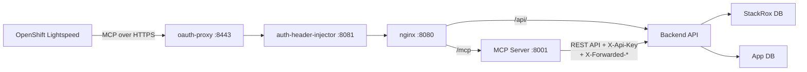

# MCP Server

RHACS Manager includes an optional [Model Context Protocol (MCP)](https://modelcontextprotocol.io/) server that exposes CVE management capabilities as tools for AI assistants like **OpenShift Lightspeed**.

## Overview

The MCP server runs as an additional sidecar container in the frontend pod, reusing the existing `oauth-proxy → auth-header-injector` authentication chain. Nginx exposes a `/mcp` endpoint that proxies to the local MCP server, which translates MCP tool calls into RHACS Manager backend API requests.

This architecture ensures namespace resolution always happens on the cluster where the namespaces live; critical for spoke deployments where namespace annotations are local to the spoke.



The MCP server forwards `X-Forwarded-Email` only when non-empty, preserving the backend's stored email when the injector has no address. Every backend request sends `Accept-Language: en` so tool errors are in English.

The auth-header-injector resolves the user's namespace scope from Kubernetes namespace annotations and injects `X-Forwarded-Namespaces` headers. Nginx forwards these to the MCP server, which then includes them (along with an `X-Api-Key`) when calling the backend.

The MCP server runs streamable HTTP in **stateless mode** (`stateless_http=True`): every request is self-contained and derives its auth context from the forwarded headers, with no in-memory session keyed by `Mcp-Session-Id`. This is required because the frontend pod runs with multiple replicas behind a Service without session affinity; consecutive MCP requests may land on different pods. Clients speaking MCP protocol `2026-07-28` are sessionless by design, so the flag only matters for older (handshake-era) clients.

## Configuration

The MCP server is configured via environment variables:

| Variable          | Default                                                    | Description                                                                                                                                                                                |
| ----------------- | ---------------------------------------------------------- | ------------------------------------------------------------------------------------------------------------------------------------------------------------------------------------------ |
| `MCP_BACKEND_URL` | `http://localhost:8000`                                    | URL of the RHACS Manager backend API.                                                                                                                                                      |
| `MCP_PORT`        | `8001`                                                     | Port the MCP server listens on.                                                                                                                                                            |
| `MCP_READONLY`    | `false`                                                    | When `true`, only read-only tools are exposed.                                                                                                                                             |
| `MCP_API_KEY`     | (empty)                                                    | Shared secret for backend spoke proxy auth.                                                                                                                                                |
| `MCP_CA_BUNDLE`   | `/var/run/secrets/kubernetes.io/serviceaccount/ca.crt`     | Path to a CA bundle for TLS verification when calling the backend. Set to `false` to disable verification, or empty to use system defaults. Missing files fall back to default verification. |
| `MCP_LOG_LEVEL`   | `info`                                                     | Python logging level (`debug`, `info`, `warning`, `error`, `critical`).                                                                                                                    |
| `SSL_CERT_FILE`   | (empty)                                                    | Standard OpenSSL variable. When set, this file becomes the base trust store of the SSL context, and the `MCP_CA_BUNDLE` CA is added on top. The Helm chart points it at the injected cluster trusted CA bundle. |

## Available Tools

### Read-only tools (always available)

| Tool | Description and parameters |
| --- | --- |
| `get_security_overview` | Dashboard counts, severity distribution, priority and high-EPSS CVEs, ranked `fix_first_cves`, fixability, aging, and risk-acceptance pipeline. Filters: `cluster`, `namespace`, `ignore_thresholds`. Chart-only fields `cve_trend`, `cve_history`, `epss_matrix`, `cluster_heatmap`, and `mttr_by_severity` are stripped. |
| `search_cves` | Filters: `search`, `severity`, `fixable`, `namespace`, `cluster`, `component`, `deployment`, `cvss_min`, `epss_min`, `age_min`, `age_max`, `prioritized_only`, `risk_status`, `remediation_status`, `fix_overdue`, `origin`, `show_remediated`, `show_suppressed`, `subscribed_only`, `ignore_thresholds`. Supports `sort_by`, `sort_desc`, `page`, `page_size` (default 20, max 200). |
| `get_cves_by_image` | Images grouped by CVE burden: totals, severity breakdown, max CVSS/EPSS, fixable counts, affected deployments, namespaces, and clusters. Filters: `cluster`, `namespace`, `search`, `severity`, `fixable`, `cvss_min`, `epss_min`, `component`, `image_name`, `origin`, `ignore_thresholds`. |
| `get_cve_detail` | Takes `cve_id`, optional `cluster` and `namespace` to narrow visibility. Includes `origin_ratings`, `is_subscribed`, `no_longer_affected`, components, timeline, links, risk acceptance, and `affected_deployments_list` with per-location remediation/suppression/acceptance flags. Includes `fix_available_since` and, for sec-team callers, `first_system_occurrence`. |
| `get_image_layers` | Takes `image_id` (StackRox UUID or digest), optional `cluster`, `namespace`, `ignore_thresholds`. Returns Containerfile instructions, metadata, and CVE summary. Use image IDs from CVE detail. |
| `get_fix_recommendations` | Component upgrade roll-up from `/api/cves/fixes`. Filters: `cluster`, `namespace`, `component`, `severity`, `fixable_only`, `prioritized_only`, `image_id`, `ignore_thresholds`; `page`, `page_size` (default 10, max 200). Keeps version choices and counts, caps each row's `cves` and `images` at 10. |
| `list_risk_acceptances` | Filters: `status` (`requested`, `approved`, `rejected`, `expired`), `cve_id`, `cluster`, `namespace`; `page`, `page_size` (default 20). |
| `list_remediations` | Filters: `status` (`open`, `in_progress`, `resolved`, `verified`, `wont_fix`), `cve_id`, `namespace`, `cluster`, `overdue`, `assigned_to` (user ID); `page`, `page_size` (default 20). `overdue=true` selects overdue open/in-progress records; false leaves all records. |
| `list_suppression_rules` | Filters: `status` (`requested`, `approved`, `rejected`), `type` (`component`, `cve`), `cve_id`; `page`, `page_size` (default 20). `cve_id` matches CVE-specific rules, not component rules that may also affect the CVE. |
| `get_escalations` | `upcoming=false` uses `/api/escalations/active/search`, with `level` and `contact_status` (`needs_action`, `contacted`, sec team only). `upcoming=true` uses `/api/escalations/upcoming/search`, with `next_level`, `severity`, `days_max`. Both accept `search`, `cluster`, `namespace`, `page`, `page_size` (default 20, max 100). Mode-specific filters apply only to their corresponding endpoint. |
| `get_settings` | Sec-team callers receive full settings including thresholds, escalation rules, `days_to_levelN_after_fix_available` anchors, `fix_overdue_threshold_days`, digest schedule, and management email. Other callers receive public thresholds. |
| `get_my_info` | Current user identity, role, and visible namespaces. |

Severity and CVSS come from the vulnerability feed, not NVD. `origin` accepts `other`, `osv`, `alpine`, `amazon`, `debian`, `oracle`, `photon`, `red_hat`, `suse`, and `ubuntu`. CVE detail exposes per-feed `origin_ratings`. Search results expose `origins`, `is_subscribed`, and `no_longer_affected`; `show_remediated=true` includes previously remediated CVEs no longer affecting the selected scope.

`ignore_thresholds=true` is a view-only noise filter opt-out and never widens namespace visibility. Subscriptions do not bypass thresholds. Search sorting supports `severity` (default), `cvss`, `epss_probability`, `affected_deployments`, `first_seen`, `published_on`, and `fix_available_since`; `sort_desc` defaults to true and prioritized CVEs always sort first. Use the EPSS-driven `impact_score` and dashboard `fix_first_cves` when advising what to fix first.

Risk acceptances, remediations, and suppression rules return an `items`, `total`, `page`, `page_size` envelope. The sidecar fetches the backend's filtered plain list and slices it locally; it does not send pagination parameters to those endpoints. Escalations use backend pagination. Active escalation responses include `contact_counts` and per-row `contacted` for sec-team callers only.

Fix recommendations preserve `target_version`, `fix_versions`, `target_uncertain`, all counts, and the envelope's `visible_cves` and `unmapped_cves`. `cves_truncated` and `images_truncated` count omitted entries per row. When `target_uncertain=true`, present **all `fix_versions`**, not only `target_version`: incomparable scanner versions mean the target may not fix every CVE.

### Write tools (disabled in readonly mode)

| Tool | Description and parameters |
| --- | --- |
| `create_risk_acceptance` | Accept a real vulnerability without an immediate fix: `cve_id`, `justification`, `scope_mode`, `scope_targets`, optional `expires_at`. Single-namespace scopes auto-approve; `all`/multi-namespace scopes require sec-team review. |
| `request_cve_suppression` | Request suppression of a false positive or inapplicable finding: `cve_id`, `reason`, `scope_mode`, `scope_targets`, optional `reference_url`. Team-member requests await review; sec-team callers approve directly. |
| `create_remediation` | Takes `cve_id`, `targets` (1 to 200 objects with `cluster_name` and `namespace`), optional `assigned_to` (user ID), `target_date` (`YYYY-MM-DD`), `notes`. Always uses `POST /api/remediations/batch`, creates all targets or none, and returns a list. |
| `update_remediation` | Replaces `update_remediation_status`. Takes `remediation_id`; optional `status`, `reason` (sent as `wont_fix_reason`), `assigned_to`, `target_date`, `notes`, `clear_fields`. Omitted or null arguments leave fields unchanged; `clear_fields` sends explicit nulls for `assigned_to`, `target_date`, or `notes`. At least one change is required; setting and clearing the same field is rejected. |
| `set_cve_subscription` | Takes `cve_id` and `subscribed`. Uses PUT to subscribe, DELETE to unsubscribe; returns `cve_id` and `subscribed`. Subscribing requires a visible affected deployment and allows at most 500 subscriptions per user. Both operations are idempotent; unsubscribing remains allowed after access is lost. |

Remediation status follows `open` → `in_progress` → `resolved`; resolved records can only reopen to `in_progress`. `wont_fix` requires `reason`; `verified` is only a legacy list filter. Assignee, target date, and notes are editable only while the current or requested status is `open` or `in_progress`.

## Prompts

Prompts seed the conversation with a tool sequence. The LLM calls the tools after the prompt is resolved. All prompts remain available in readonly mode.

| Prompt | Arguments | Workflow |
| --- | --- | --- |
| `triage_namespace` | `namespace`, optional `cluster` | Prioritized CVEs → overdue fixes → upcoming escalations → existing remediations → component fix recommendations. Carries cluster scope through every step. |
| `investigate_cve` | `cve_id` | CVE detail and blast radius → image layers → risk acceptances and remediations → CVE-specific suppression rules. |
| `weekly_security_review` | None | Dashboard → paginated upcoming escalations → pending risk-acceptance reviews → remediation work in flight. |

## Local Development

Start the backend and MCP server together:

```bash
# Terminal 1: start the backend
just dev

# Terminal 2: start the MCP server
just dev-mcp

# Or in readonly mode
just dev-mcp-readonly
```

The MCP server will be available at `http://localhost:8001/mcp`.

## Helm Deployment

The MCP server runs as a sidecar container in the frontend pod using its own dedicated lightweight image (`rhacs-manager-mcp-server`). When enabled, the frontend pod grows from 3 containers (oauth-proxy, auth-header-injector, nginx) to 4 (adding mcp-server). The MCP endpoint is exposed at `/mcp` on the existing frontend Route; no additional Services or Routes are needed.

### Hub Mode

```yaml
mcp:
  enabled: true
  readonly: false # set to true for read-only mode
  secret:
    create: true # chart creates the secret from stringData below
    name: rhacs-manager-mcp
    stringData:
      MCP_API_KEY: "<key matching a backend SPOKE_API_KEYS entry>"
```

The `MCP_API_KEY` must match one of the `SPOKE_API_KEYS` configured on the backend. The MCP server calls the backend directly via the in-cluster service URL.

By default (`secret.create: true`) the chart creates the `rhacs-manager-mcp` secret for you, and an empty `MCP_API_KEY` fails the install with a clear error. To manage the secret yourself, set `secret.create: false` and pre-create a secret named `rhacs-manager-mcp` containing an `MCP_API_KEY` key.

### Spoke Mode

```yaml
spoke:
  mcp:
    enabled: true
    readonly: true
```

In spoke mode, the MCP server uses the same `HUB_API_URL` and `SPOKE_API_KEY` from the spoke secret to reach the hub backend; identical to how the spoke frontend proxies `/api/` requests.

### Cluster Trusted CA Bundle

The hub route certificate is typically signed by the cluster's ingress or enterprise CA, not by the OpenShift service CA. To make TLS verification against the hub work out of the box, the chart creates a ConfigMap labeled `config.openshift.io/inject-trusted-cabundle: "true"` (`rhacs-manager-mcp-trusted-cabundle`). The Cluster Network Operator injects the cluster-wide trusted CA bundle (system roots plus any proxy `additionalTrustBundle`) into it, and the chart mounts it into the MCP server container with `SSL_CERT_FILE` pointing at it.

The MCP server's resulting trust store is the cluster trusted CA bundle plus the service CA from `MCP_CA_BUNDLE`. On non-OpenShift clusters the ConfigMap stays empty and the mount is harmless.

### Example

```bash
# Hub deployment with MCP enabled
helm upgrade --install rhacs-manager deploy/helm/rhacs-manager \
  -n rhacs-manager \
  --set mcp.enabled=true \
  --set mcp.readonly=true \
  --set mcp.secret.stringData.MCP_API_KEY=<key-matching-a-backend-SPOKE_API_KEYS-entry>

# Spoke deployment with MCP enabled
helm upgrade --install rhacs-manager deploy/helm/rhacs-manager \
  -n rhacs-manager \
  --set mode=spoke \
  --set spoke.mcp.enabled=true
```

## OpenShift Lightspeed Integration

Once the MCP server is enabled, configure OpenShift Lightspeed to connect to the `/mcp` endpoint on the frontend service using the cluster-internal FQDN.

### Prerequisites

The frontend service uses a serving certificate issued by the OpenShift service CA. To let OLS trust this certificate, create a ConfigMap with the `service.beta.openshift.io/inject-cabundle` annotation in the `openshift-lightspeed` namespace:

```yaml
apiVersion: v1
kind: ConfigMap
metadata:
  name: rhacs-manager-serving-ca
  namespace: openshift-lightspeed
  annotations:
    service.beta.openshift.io/inject-cabundle: "true"
data: {}
```

### Configure OLSConfig

```yaml
apiVersion: ols.openshift.io/v1alpha1
kind: OLSConfig
metadata:
  name: cluster
spec:
  featureGates:
    - MCPServer
  ols:
    additionalCAConfigMapRef:
      name: rhacs-manager-serving-ca
  mcpServers:
    - name: rhacs-manager
      url: https://rhacs-manager-frontend.rhacs-manager.svc:8443/mcp
      headers:
        - name: Authorization
          valueFrom:
            type: kubernetes
```

The oauth-proxy authenticates the user via OpenShift OAuth, the auth-header-injector resolves their namespace scope from Kubernetes namespace annotations on the local cluster, and the MCP server forwards these identity headers to the backend. The user's OpenShift identity determines which namespaces and actions are available.

## Plain HTTP

By default the MCP endpoint is only reachable through the oauth-proxy HTTPS port (8443). If you need a plain HTTP port; for example when TLS is terminated at an external load balancer or ingress; enable `plainHttp`:

```yaml
# Hub
mcp:
  enabled: true
  plainHttp:
    enabled: true
    port: 8082  # default

# Spoke
spoke:
  mcp:
    enabled: true
    plainHttp:
      enabled: true
      port: 8082  # default
```

Traffic on the plain HTTP port still flows through the full oauth-proxy authentication chain, so `X-Forwarded-*` headers are set correctly. The only difference is that TLS is not used on the Service port itself.

Enabling `plainHttp` also configures `--openshift-delegate-urls` on oauth-proxy, which allows bearer token authentication in addition to the cookie-based OAuth flow. This is required for service-to-service clients like OpenShift Lightspeed, which forward the end user's bearer token with each request. The delegate URL performs a SubjectAccessReview checking that the user can create `selfsubjectaccessreviews`; a permission every authenticated OpenShift user has by default.

When using plain HTTP with OLS, the `additionalCAConfigMapRef` is no longer needed:

```yaml
mcpServers:
  - name: rhacs-manager
    url: http://rhacs-manager-frontend.rhacs-manager.svc:8082/mcp
    headers:
      - name: Authorization
        valueFrom:
          type: kubernetes
```

## Readonly Mode

When `MCP_READONLY=true`, write tools (`create_risk_acceptance`, `request_cve_suppression`, `create_remediation`, `update_remediation`, `set_cve_subscription`) are not registered. They will not appear in the tool list, preventing the AI assistant from attempting any mutations. Read-only tools and prompts remain available.

This is recommended for initial rollouts or environments where AI-driven changes are not yet approved.
